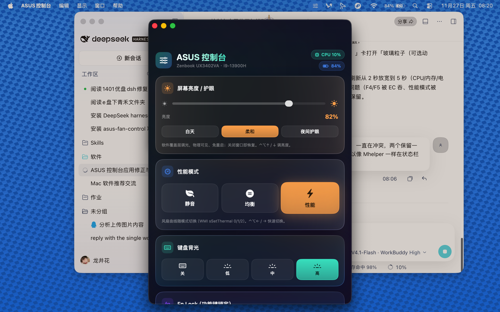
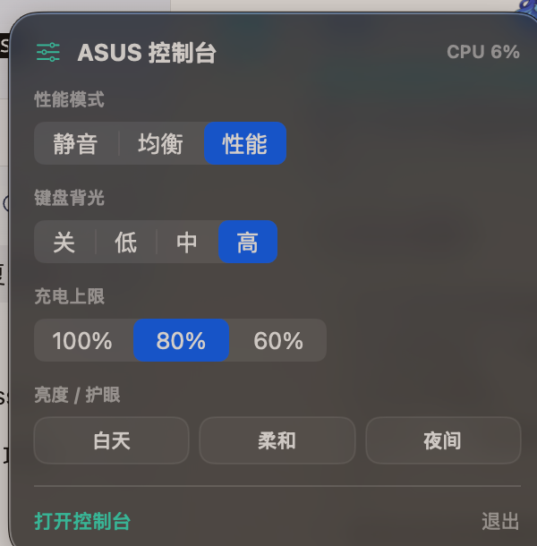

# ASUS 控制台（SwiftUI 原生 App）

在没有官方 Armoury Crate 的黑苹果上，用 **ASUS WMI**（MHelper 的内核驱动 `org.franciumos.mhelper.driver`，服务名 `AsusWMIControl`）自己实现的原生 macOS 控制台。纯 SwiftUI + AppKit + IOKit，无第三方依赖。



## 功能

| 功能 | 实现 |
| --- | --- |
| 屏幕亮度 / 护眼 | 全屏覆盖层软件调光（暗罩 + 暖罩），预设 **白天 / 柔和 / 夜间护眼**；`⌃⌥↑/↓` 调节 |
| 性能模式 | 静音 / 均衡 / 性能 → WMI `sSetThermal` 0/1/2；`⌃⌥←/→` 切换 |
| 键盘背光 | 关 / 低 / 中 / 高 → `sSetKbd` 0..3 |
| 充电上限 | 100% / 80% / 60% → `sSetCharge` |
| Fn Lock | 功能键锁定开关 → `sSetFnLock`(sel 10)，读 off68 回显 |
| 系统状态 | CPU / 内存 / 电池 / 当前模式，2 秒刷新 |
| 菜单栏常驻 | 菜单栏图标点开即调性能 / 背光 / 充电 / 亮度预设，不开主窗口 |
| 界面 | 全中文、Liquid Glass（`.glassEffect`）卡片、可选玻璃粒子动效（默认关闭，省电） |



## 构建与安装

需要 Xcode CommandLineTools（`swiftc`）。不要加 `-framework IOKit.ps`。

```bash
bash 构建.sh
open -a "/Applications/ASUS控制台.app"
```

脚本会 `swiftc -O -parse-as-library main.swift` → 打包 `/Applications/ASUS控制台.app` → `codesign --force --deep --sign -`（ad-hoc）。

## 文件

- `main.swift` — 全部实现（WMI 封装、覆盖层调光、热键、监控、SwiftUI 界面、菜单栏）
- `icon.swift` / `AppIcon.icns` — 图标
- `构建.sh` — 构建 + 打包 + 签名
- `技术数据.md` — WMI selector、sGetInfo 内存布局、能力逆向结论、各轮改动记录
- `交接-提示词.md` — 交给下一个会话继续开发的提示词

## 已知限制（本机型）

- **Fn+F4/F5 / 风扇物理键在 EC/ATKD 层被消费**，用户态收不到，App 无法拦截；请用 `⌃⌥↑/↓`（亮度）与 `⌃⌥←/→`（性能）。
- WMI 不提供风扇转速 / 温度读数。
- 驱动层不支持（返回 `kIOReturnUnsupported`）：RGB（sel 2/3）、PanelOD(6)、dGPU(7)、风扇曲线读写(8/9)、开机提示音(11)。MHelper 里这些功能在本机同样无效。
- 无原生背光 PWM，亮度只能软件覆盖层。

## 与 MHelper 的关系（v1.1）

MHelper 会周期性重载偏好并回写策略，导致与本 App 抢设置，因此 v1.1 起：

- 移除 MHelper 登录项，**只保留本 App 作为唯一控制源**；
- 启动时及每 2 秒检查，MHelper 若被拉起会自动退出；
- 设置持久化在 `com.local.asusconsole`，开机自动回写；
- 菜单栏常驻，关闭主窗口不退出 App。

如需恢复 MHelper 自启：

```bash
osascript -e 'tell application "System Events" to make login item at end with properties {path:"/Applications/MHelper.app", hidden:false}'
```

## 版本

- **v1.1（2026-11-27）**：合并 MHelper（单一控制源）、菜单栏常驻面板、关窗不退出、Liquid Glass 界面、全中文、Fn Lock、背景动画按反馈改为静态。
- v1.0：初版（亮度覆盖层、性能模式、键盘背光、充电上限、系统状态）。
